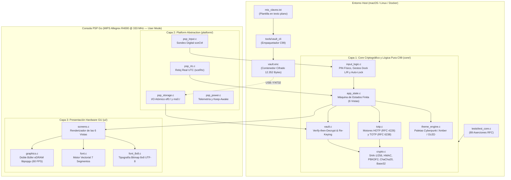
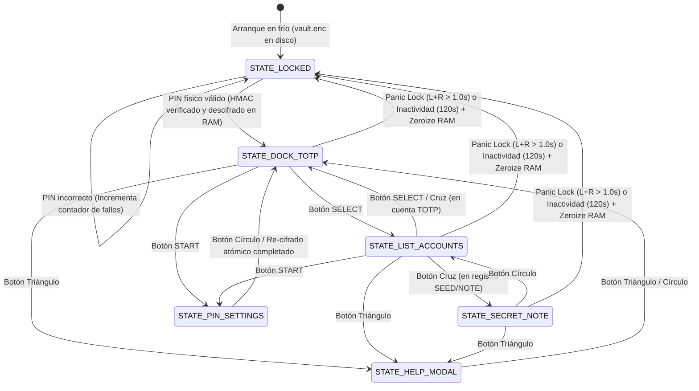

# Especificación Técnica de Arquitectura — PSP Go Air-Gapped Hardware TOTP & Seed Vault (`04_HardwareTotp_Vault`)

> **Memoria de ingeniería de software embebido, especificación criptográfica a nivel de byte, formulación matemática de derivación y truncado dinámico, topología de memoria RAM/eDRAM y directivas de seguridad física para la consola Sony PSP Go (PSP-N1000).**

---

## 1. Visión Arquitectónica y Modelo de Amenazas (*Threat Model*)

`04_HardwareTotp_Vault` transforma una consola portátil **Sony PSP Go (PSP-N1000)** con el interruptor físico **WLAN apagado** en un **token criptográfico hardware 100% fuera de línea (*air-gapped*)** para generación de códigos temporales de segundo factor (**TOTP — RFC 6238** y **HOTP — RFC 4226**) y custodia de semillas críticas (frases mnemotécnicas BIP-39, huellas SSH/GPG y contraseñas maestras).

### 1.1. Garantías del Modelo de Seguridad
1. **Aislamiento Físico de Red (*Hard Air-Gap*)**: El ejecutable `EBOOT.PBP` no enlaza ni importa ninguna biblioteca de red del SDK (`libpspnet`, `libpspnet_inet`, `libpspnet_apctl`, `libpspwlan`). Incluso si el interruptor físico WLAN estuviese encendido accidentalmente, el binario carece de código capaz de inicializar el chip Wi-Fi.
2. **Cero Secretos en Reposo (*Zero Plaintext at Rest*)**: El archivo contenedor `vault.enc` almacenado en la memoria flash de usuario (`ef0:/PSP/GAME/TotpVault/vault.enc` o `ms0:/PSP/GAME/TotpVault/vault.enc`) cifra la totalidad de las cuentas, etiquetas y semillas mediante **ChaCha20 (RFC 8439)** autenticado con **HMAC-SHA256 (RFC 2104)** bajo el esquema **Verify-then-Decrypt**.
3. **Derivación de Clave por Combinación Física de Botones**: El contenedor jamás almacena la clave de cifrado ni un hash directo del PIN. En el arranque, la secuencia de botones físicos introducida por el usuario ($2$, $4$ u $8$ pulsaciones de cruceta, gatillos o botones de acción) alimenta **PBKDF2-HMAC-SHA256 (RFC 8018)** con $10.000$ iteraciones y una sal aleatoria de $128\text{ bits}$.
4. **Efimeridad en Memoria Volátil y Purgado Activo (`crypto_zeroize`)**: Los secretos descifrados residen exclusivamente en la sección estática `.bss` de la memoria RAM principal de 64 MB mientras la sesión está activa. Ante inactividad ($120\text{ segundos}$), bloqueo de emergencia (*Panic Lock* mediante acorde `L + R`) o salida al menú XMB, toda la estructura en RAM y las claves derivadas se sobrescriben con ceros mediante punteros `volatile uint8_t *` inmunes a la optimización del compilador.

---

## 2. Arquitectura Modular en 3 Capas

El sistema separa de forma estricta la lógica criptográfica y de negocio (`core/`), los controladores específicos del silicio MIPS Allegrex (`platform/`) y el motor de renderizado vectorial acelerado por hardware (`ui/`):



---

## 3. Especificación Criptográfica (`core/crypto.c` y `core/totp.c`)

### 3.1. Derivación de Claves mediante PBKDF2-HMAC-SHA256 (RFC 8018)
Cada botón físico de la consola se codifica de manera determinista en un byte ASCII canónico (`'U'`, `'D'`, `'L'`, `'R'`, `'<'`, `'>'`, `'X'`, `'O'`, `'S'`, `'T'`). Dada una secuencia de botones $P$ de longitud $L \in \{2, 4, 8\}$ y una sal aleatoria $S \in \{0,1\}^{128}$ ($16\text{ bytes}$) almacenada en la cabecera de `vault.enc`, el motor ejecuta $c = 10.000$ iteraciones de $\operatorname{HMAC-SHA256}$ para derivar un bloque maestro $\text{DK}$ de $64\text{ bytes}$ ($512\text{ bits}$):

$$\text{DK}_{64} = T_1 \parallel T_2, \quad \text{donde } T_i = U_1 \oplus U_2 \oplus \cdots \oplus U_{10000}$$

$$U_1 = \operatorname{HMAC-SHA256}(P, S \parallel \operatorname{INT}_{32\text{-BE}}(i)), \qquad U_j = \operatorname{HMAC-SHA256}(P, U_{j-1})$$

El bloque derivado $\text{DK}_{64}$ se particiona en dos subclaves criptográficamente independientes de $256\text{ bits}$ cada una:
* **Clave de Cifrado Simétrico ($K_{\text{enc}}$)**: $\text{DK}[0..31]$ ($32\text{ bytes}$), suministrada al cifrador de flujo ChaCha20.
* **Clave de Autenticación de Integridad ($K_{\text{mac}}$)**: $\text{DK}[32..63]$ ($32\text{ bytes}$), suministrada al validador HMAC-SHA256.

### 3.2. Cifrador de Flujo ChaCha20 (RFC 8439)
La matriz de estado interna de ChaCha20 consta de $16$ palabras de $32\text{ bits}$ ($64\text{ bytes}$ por bloque) inicializadas en formato *little-endian* (nativo para la arquitectura MIPS Allegrex):

$$\begin{pmatrix}
\texttt{0x61707865} & \texttt{0x3320646e} & \texttt{0x79622d32} & \texttt{0x6b206574} \\
k_0 & k_1 & k_2 & k_3 \\
k_4 & k_5 & k_6 & k_7 \\
\text{counter} & n_0 & n_1 & n_2
\end{pmatrix}$$

En cada bloque se ejecutan **20 rondas** (10 rondas de columna alternadas con 10 rondas diagonales) basadas exclusivamente en operaciones **ARX** (*Add-Rotate-Xor* en 32 bits):

$$a \mathrel{+}= b; \; d \mathrel{\oplus}= a; \; d \lll= 16; \quad c \mathrel{+}= d; \; b \mathrel{\oplus}= c; \; b \lll= 12; \quad a \mathrel{+}= b; \; d \mathrel{\oplus}= a; \; d \lll= 8; \quad c \mathrel{+}= d; \; b \mathrel{\oplus}= c; \; b \lll= 7$$

Esta construcción garantiza **tiempo de ejecución constante**, inmunidad total frente a ataques de temporización por caché (*cache-timing attacks*) y ausencia de tablas S-Box en memoria.

### 3.3. Motores HOTP (RFC 4226) y TOTP (RFC 6238)
Dada una semilla secreta $K$ decodificada desde **Base32 (RFC 4648)** y un instante de tiempo Unix UTC $t_{\text{UTC}}$:
1. **Factor de Paso Temporal ($T$)**: Con intervalo estándar $X = 30\text{ s}$:
   $$T = \left\lfloor \frac{t_{\text{UTC}}}{30} \right\rfloor, \qquad t_{\text{restante}} = 30 - (t_{\text{UTC}} \bmod 30)$$
2. **Empaquetado Big-Endian de 64 bits**: El contador $T$ se serializa en un arreglo de $8\text{ bytes}$ en orden de red (*big-endian*): $C_8 = \operatorname{BE}_{64}(T)$.
3. **Cálculo de HMAC Multi-Algoritmo**: Según la configuración de la cuenta, se evalúa $H = \operatorname{HMAC-SHA1}(K, C_8)$ ($20\text{ bytes}$) o $H = \operatorname{HMAC-SHA256}(K, C_8)$ ($32\text{ bytes}$).
4. **Truncado Dinámico (*Dynamic Truncation*)**:
   $$O = H[\text{len}(H) - 1] \mathbin{\&} \texttt{0x0F}$$
   $$P = \left((H[O] \mathbin{\&} \texttt{0x7F}) \ll 24\right) \mid \left(H[O+1] \ll 16\right) \mid \left(H[O+2] \ll 8\right) \mid H[O+3]$$
   $$\text{Código TOTP} = P \bmod 10^d \quad (d \in \{6, 8\})$$

---

## 4. Disposición Binaria a Nivel de Byte de `vault.enc` (`core/vault.c`)

El archivo `vault.enc` posee un tamaño fijo e invariante de **12.352 bytes** (`0x3040` bytes), lo que impide ataques de análisis de tráfico por tamaño de archivo (un cofre con 1 cuenta ocupa exactamente los mismos 12.352 bytes en disco que un cofre con 32 cuentas).

```
+-----------------------------------------------------------------------+ 0x0000 (Byte 0)
| CABECERA PÚBLICA (VaultHeader — 32 Bytes en claro)                    |
|   0x0000..0x0003 : magic[4]       = "PSPV" (0x50, 0x53, 0x50, 0x56)   |
|   0x0004         : version        = 0x01                              |
|   0x0005         : pin_length     = 2, 4 u 8 pulsaciones              |
|   0x0006         : entry_count    = Número de registros activos (0..32)|
|   0x0007         : reserved       = 0x00                              |
|   0x0008..0x0017 : salt[16]       = Sal aleatoria de 128 bits (PBKDF2)|
|   0x0018..0x0023 : nonce[12]      = Nonce de 96 bits (ChaCha20)       |
+-----------------------------------------------------------------------+ 0x0020 (Byte 32)
| CARGA ÚTIL CIFRADA (Ciphertext — 12.288 Bytes = 32 × 384 Bytes)       |
|   Cifrada con ChaCha20(K_enc, counter = 1, nonce).                    |
|   Cada VaultRecord (384 bytes exactos) contiene:                      |
|     +0x000 (1 B)   : type         (0=TOTP, 1=HOTP, 2=SEED_NOTE)       |
|     +0x001 (1 B)   : algo         (0=SHA1, 1=SHA256)                  |
|     +0x002 (1 B)   : digits       (6 u 8 dígitos)                     |
|     +0x003 (1 B)   : period       (30 segundos por defecto)           |
|     +0x004 (28 B)  : issuer[28]   (Nombre del proveedor, NUL-padded)  |
|     +0x020 (36 B)  : label[36]    (Cuenta / identificador, NUL-padded)|
|     +0x044 (64 B)  : secret[64]   (Semilla binaria cruda decodificada)|
|     +0x084 (1 B)   : secret_len   (Longitud real de la semilla: 1..64)|
|     +0x085 (3 B)   : pad[3]       (Alineación explícita a 8 bytes)    |
|     +0x088 (8 B)   : counter      (Contador uint64_t para HOTP)       |
|     +0x090 (240 B) : note[240]    (Frase BIP-39 / SSH / Clave secreta)|
+-----------------------------------------------------------------------+ 0x3020 (Byte 12.320)
| ETIQUETA DE AUTENTICACIÓN (HMAC-SHA256 Tag — 32 Bytes)                |
|   0x3020..0x303F : hmac_tag[32]   = HMAC-SHA256(K_mac, Bytes 0..12319)|
+-----------------------------------------------------------------------+ 0x3040 (12.352 Bytes)
```

### Protocolo *Verify-then-Decrypt* en Tiempo Constante
Al intentar desbloquear la bóveda con un PIN físico:
1. Se calcula $T_{\text{calc}} = \operatorname{HMAC-SHA256}(K_{\text{mac}}, \text{Header}_{32} \parallel \text{Ciphertext}_{12288})$.
2. Se compara $T_{\text{calc}}$ frente a `hmac_tag[32]` mediante `crypto_consttime_equal()`, acumulando diferencias con el operador bit a bit `diff |= a[i] ^ b[i]` sobre los 32 bytes sin saltos condicionales.
3. Si `diff != 0`, la función limpia inmediatamente $K_{\text{enc}}$ y $K_{\text{mac}}$ con `crypto_zeroize()`, incrementa el contador de intentos fallidos y **jamás llega a invocar el descifrador ChaCha20**, protegiendo la memoria RAM frente a cualquier corrupción o filtración parcial.

---

## 5. Máquina de Estados Finita y Flujo de Interfaz (`core/app_state.c`)



---

## 6. Topología de Memoria y Directivas Anti-Brick en PSP Go

| Región de Memoria | Ubicación / Tamaño | Uso en `04_HardwareTotp_Vault` |
|---|---|---|
| **Espacio de Ejecución** | `PSP_MODULE_INFO(..., 0, 1, 1)` | Modo Usuario estricto (*User Mode*). Acceso a `flash0:` bloqueado por hardware. |
| **Pila del Hilo Principal** | `512 KB` (`PSP_MAIN_THREAD_STACK_SIZE_KB(512)`) | Evita desbordamientos de pila durante las 10.000 rondas de PBKDF2. |
| **Sección `.bss` Estática** | `g_app` (~13 KB) y `s_file_cache` (~12.3 KB) | Alojamiento estático alineado fuera de la pila; purgado con `crypto_zeroize()` al salir. |
| **VRAM (eDRAM Gráfica)** | `0x00000000` (Front) / `0x00088000` (Back) | Doble búfer de $512 \times 272 \times 4\text{ bytes}$ RGBA8888 renderizado vía `libpspgu` a 60 FPS. |
| **Escritura Atómica FAT32** | `vault.enc.tmp` $\rightarrow$ `vault.enc` | Al cambiar el PIN desde la consola, se escribe primero en un archivo temporal, se verifica su integridad y se renombra atómicamente para impedir corrupción ante pérdida de batería. |
